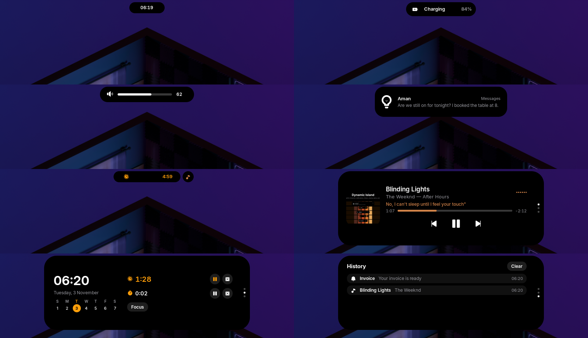
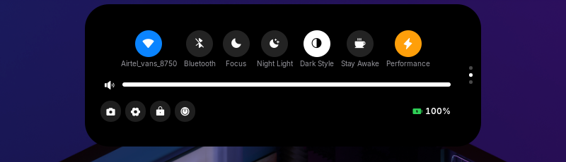

# Dynamic Island for GNOME

A solid black, iPhone-style Dynamic Island for GNOME Shell 50, ported from
[omarchy-dynamic-island](https://github.com/buildscript-dev/omarchy-dynamic-island).
It springs open for music, timers, recording, notifications, volume, brightness
and system alerts, then gets out of the way. The GNOME top bar is hidden; it
comes back in the overview.





## Install

```sh
./install.sh            # links this folder into ~/.local/share/gnome-shell/extensions
# log out and back in once (Wayland), then:
gnome-extensions enable dynamic-island@buildscript-dev.github.io
```

Optional: `brew install cava` for a waveform that follows the real audio.
Settings: `gnome-extensions prefs dynamic-island@buildscript-dev.github.io`.

## What it shows

- **Idle**: a small pill with the clock.
- **Live activities**: music (art + album-tinted waveform), timer, stopwatch,
  screen recording (GNOME's recorder), ringing alarm. A second one detaches
  into a bubble beside the island.
- **HUD**: volume, brightness, keyboard backlight (replaces GNOME's OSD).
- **Alerts**: charging, on battery, low battery, Bluetooth, network, Do Not Disturb.
- **Notifications**: replace GNOME's banners. Click opens, right-click dismisses.
- **Expanded** (hover or click), scroll for pages: Now Playing with synced
  lyrics (lrclib.net) and a seekable scrubber, Home (clock, week, timers,
  stopwatch, Focus), History.
- **Control Center** page (the top bar is hidden, so this replaces Quick
  Settings): Wi-Fi, Bluetooth, Focus, Night Light, Dark Style, Stay Awake,
  power mode, volume and brightness sliders, screenshot, settings, lock,
  power off, laptop battery and phone battery (tap the phone to ring it).
- Orange dot while an app uses the microphone.

## Synced with the laptop and phone

- Follows the screen you work on (or pin it to the laptop or external monitor).
- Alerts for power mode, Night Light, audio output switches, Caps Lock,
  keyboard layout and workspace switches.
- Phone through GSConnect: connect/disconnect and battery alerts, battery in
  Home and Controls, ring your phone. Phone notifications and calls come in
  as GNOME notifications and show in the island. Pair the phone with the
  KDE Connect app first (Settings > Devices > Open GSConnect).

## Gestures

Hover or click to open, scroll to page (or set scrolling to change the
volume), middle-click play/pause, right-click dismisses a notification or
snoozes an alarm. **Super+Alt+I** opens or closes the island.

## D-Bus

```sh
I=io.github.buildscript_dev.DynamicIsland
call() { gdbus call --session -d org.gnome.Shell -o /io/github/buildscript_dev/DynamicIsland -m $I.$1 "${@:2}"; }
call Timer 300; call TimerCancel; call Stopwatch; call StopwatchReset
call Alarm 7:30; call AlarmCancel; call Expand; call Collapse; call State
call Alert charging "Hello" "42%"; call Hud volume 40
```

## Not yet ported

Genie minimize, earbuds, call view.

## License

MIT. Not affiliated with Apple.
